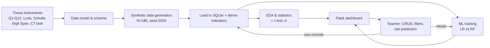
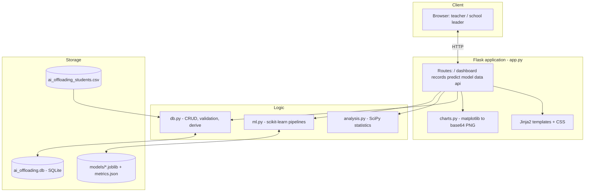
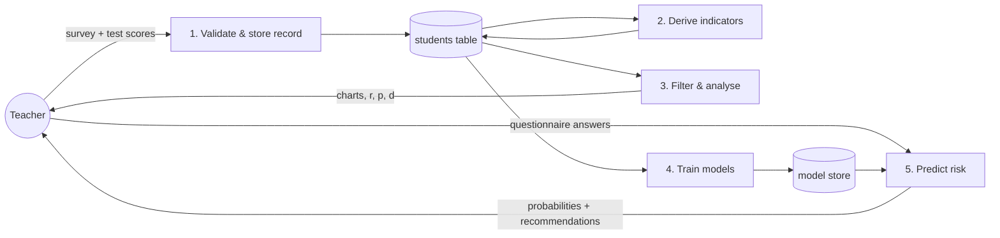
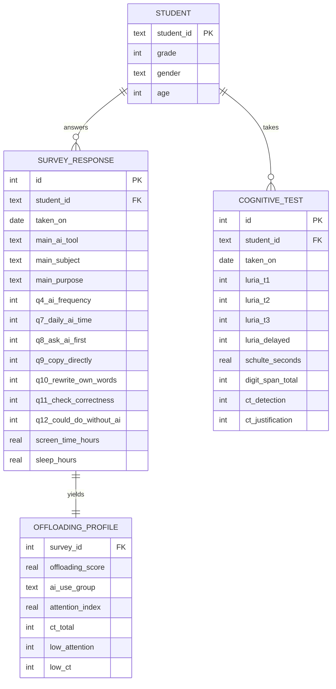
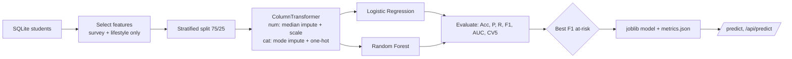
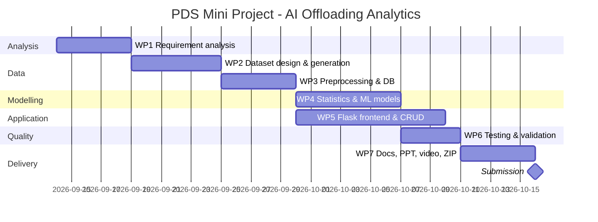

# Student AI-Use & Cognitive Offloading Analytics
### A data-science decision-support system for monitoring AI-based cognitive offloading, attention and critical thinking in grades 8–9

---

## 1. Cover Page

| | |
|---|---|
| **Project Title** | Student AI-Use & Cognitive Offloading Analytics: a data-science system for attention and critical-thinking risk screening in a Latvian international school |
| **Student Name** | Oleg Mishchenko |
| **Student ID** | [STUDENT ID] |
| **Programme** | [Master programme name, e.g. Business Management / Information Systems] |
| **Subject** | Programming for Data Science |
| **Faculty / Supervisor** | Amit Joshi [verify] |
| **University** | Riga Nordic University, Department of Natural Sciences and Information Technologies |
| **Semester & Academic Year** | [Semester], 2025/2026 |
| **Submission Date** | [DD.MM.2026] |

---

## 2. Abstract / Executive Summary

**Objective.** The project builds a working data-science application that measures how much 8th and 9th grade students offload thinking to AI tools, and tests whether this offloading relates to attention and critical thinking. It is the software counterpart of the author's Master's thesis *"Use of AI Tools and Cognitive Offloading among 8th and 9th Grade Students: Associations with Attention and Critical Thinking in a Latvian International School"*.

**Problem.** Generative AI (ChatGPT, Gemini, Copilot) is now part of everyday homework. The literature links heavy AI reliance to weaker critical thinking (Gerlich, 2025: r = −0.68; Tian & Zhang, 2025: r = −0.35) and links screen exposure to concentration problems (Leonhardt et al., 2025: +51% risk above 2 h/day). Schools still have no student-level data or tools for monitoring this. The thesis study had n = 12, which is too small to test its hypothesis (critical r = 0.576).

**Methodology.** The thesis instruments were turned into a structured data model: the 12-item questionnaire, the AI Offloading Composite Score (Q4, Q8, Q9, reversed Q10–Q12), Luria's 10 Words, Schulte Tables, Digit Span and the "Survival Story" critical-thinking task. A synthetic, thesis-calibrated dataset of N = 180 students was generated, loaded into SQLite and analysed with Pearson/Spearman correlation, Welch t-tests and effect sizes. Logistic Regression and Random Forest classifiers predict *low attention* and *low critical thinking* from AI-use answers only.

**Technologies.** Python 3.13, Flask, SQLite, pandas, NumPy, SciPy, scikit-learn, matplotlib, Jinja2/HTML/CSS.

**Results.** The simulated replication shows the hypothesised pattern: offloading correlates with the attention index at r = −0.58 and with critical thinking at r = −0.53 (both p < 0.001). The Higher AI-use group scores lower on all cognitive measures (Cohen's d from −0.73 to −0.90). The best low-attention model (Logistic Regression) reaches F1 = 0.76, recall = 1.00 and ROC-AUC = 0.96 on the test set (5-fold CV F1 = 0.66). The best low-critical-thinking model (Random Forest) reaches F1 = 0.65 and ROC-AUC = 0.75 (CV F1 = 0.68). The app provides a dashboard, full CRUD, risk prediction with recommendations, model evaluation and a data-quality view.

---

## 3. Introduction

**Background.** AI tools have become part of students' daily learning routines: explanations, grammar correction, translation, idea generation and, sometimes, complete answers. *Cognitive offloading* means using external tools to reduce the cognitive demand of a task (Risko & Gilbert, 2016). It improves immediate performance but can weaken long-term retention and independent reasoning (Peng & Yeh, 2025). Lower secondary students (ages 13–15) are in a sensitive period for developing executive functions, so this question matters most for them.

**Need for the solution.** The thesis found that all surveyed students use AI. Use was mostly reflective: 92% never or rarely copy AI text and 75% rewrite AI answers. However, the Higher AI-use group showed a weaker active-processing profile (mean offloading 2.20 vs 1.83). Teachers have no instrument for spotting the students whose AI use is drifting from *support* to *substitution*.

**Research and industry relevance.** In Latvia, 42% of 15-year-olds report digital distraction in class, against an OECD average of 30% (OECD, 2023). The thesis also stresses a business-management angle: AI reliance habits formed at school carry over into professional teams, where the same offloading risk affects decision quality.

**Current challenges.** Evidence comes mostly from university or adult samples. School studies are small. Paper-and-pencil test data sit in spreadsheets, and no screening model links questionnaire behaviour to cognitive outcomes.

---

## 4. Problem Statement

* **Existing problem.** Growing AI use at school may reduce students' independent thinking and concentration, but schools have no student-level data for checking this (thesis, "Problem of the research").
* **Why it matters.** Attention and critical thinking predict academic success and later professional performance. Uncritical AI use is linked to "increased laziness" in 68.9% of students and degraded decision-making in 27.7% (Zhai et al., 2024).
* **Current limitations.** The thesis sample (n = 12) could not detect medium effects. Its observed correlations were r = +0.26 to +0.30, not significant. Data were analysed by hand, and there is no repeatable pipeline, database or predictive component.
* **Need for a data-science solution.** The school needs a reproducible pipeline (collect → store → derive indicators → analyse → predict) that scales to larger cohorts, recomputes the composite scores consistently, quantifies relationships with proper statistics, and flags at-risk students early.

---

## 5. Project Objectives

**Main objective.** Develop a web-based data-science system that operationalises the thesis methodology and evaluates and predicts the link between AI-based cognitive offloading and students' attention and critical thinking.

**Specific objectives**
1. Model the thesis instruments as a relational schema with automatically derived indicators.
2. Generate a thesis-calibrated synthetic dataset (N = 180) with realistic missing data.
3. Provide descriptive and inferential analytics that mirror thesis Tables 4.3, 4.7 and 4.8.
4. Train and compare classifiers for *low attention* and *low critical thinking*.
5. Provide CRUD so teachers can enter new survey and test results.

**Measurable goals**
* Composite scores recomputed for 100% of records, with ≥ 4 of 6 items required for the offloading score.
* Classifier F1 (at-risk class) ≥ 0.60 and ROC-AUC ≥ 0.75, both above the majority baseline. **Achieved: 0.76 / 0.96 and 0.65 / 0.75.**
* All pages respond in under 2 s on a laptop with N = 180.
* 8 automated tests pass.

**Functional goals.** Dashboard with five filters, CRUD with validation, prediction form plus JSON API, retrain button, CSV export.

---

## 6. Literature Review (MANDATORY)

### 6.1 Existing systems
* **LMS analytics** (Moodle Analytics, Google Classroom) track logins and grades, not AI-use behaviour or cognition.
* **AI-detection tools** (Turnitin AI, GPTZero) classify *texts*, not *students' cognitive habits*. They also have high false-positive rates and no developmental view.
* **Psychological test batteries** (Wechsler Digit Span, Luria, Schulte) are validated but run on paper, with no link to behaviour data.
* **Adaptive tutoring systems** personalise learning (Ansari & Qamari, 2025) but do not measure offloading.

### 6.2 Research papers (from the thesis evidence base)

| # | Study | Sample | Key finding relevant to the system |
|---|---|---|---|
| 1 | Gerlich (2025) | 655 adults | AI use ↔ offloading r = +0.72; AI use ↔ critical thinking r = −0.68; offloading mediates the effect (b = −0.42) |
| 2 | Tian & Zhang (2025) | 580 students | AI dependence ↔ CT r = −0.35; cognitive fatigue mediates; information literacy protects |
| 3 | Risko & Gilbert (2016) | review | Defines cognitive offloading; trade-off between performance and memory |
| 4 | Peng & Yeh (2025) | experiment | Offloading > 90% accurate on easy tasks; high trust → more offloading |
| 5 | Zhai et al. (2024) | 14 studies | Over-reliance on AI dialogue systems reduces analytical thinking |
| 6 | Leonhardt, Danielsen & Andersen (2025) | 33 studies | > 2 h/day screen time → 51% higher risk of concentration problems |
| 7 | Sina et al. (2024), I.Family | 8,673 children, 9 EU countries | Each extra hour of smartphone use → higher impulsivity (β = 0.74) |
| 8 | Clemente-Suarez et al. (2024) | 157+ studies | Prolonged screen time reduces sustained attention |
| 9 | Vedechkina & Borgonovi (2021) | review | Effects depend on content, user and context |
| 10 | Kundu & Bej (2025) | 24 studies | AI raises engagement but lowers CT and raises anxiety |
| 11 | OECD PISA 2022 (2023) | 5,373 Latvian students | 42% distracted by devices (OECD 30%) |

### 6.3 Current approaches
Cross-sectional surveys combined with regression or mediation analysis (Gerlich; Tian & Zhang), large cohort studies (I.Family) and systematic reviews. Machine learning is rarely used, and when it is, it is applied to LMS logs rather than to offloading behaviour.

### 6.4 Research gaps
1. No studies focus on **lower secondary students in the Baltic region** (Kundu & Bej, 2025; thesis §2.4).
2. Studies separate *how* AI is used (copy vs rewrite vs verify) from objective cognitive tests.
3. Results are not turned into **operational tools** for teachers.
4. Small school samples lack statistical power. The thesis (n = 12) needed |r| > 0.576.

### 6.5 Comparative analysis

| Criterion | LMS analytics | AI-text detectors | Paper test batteries | Thesis (manual) | **This system** |
|---|---|---|---|---|---|
| Measures AI-use behaviour | ✗ | partly (text) | ✗ | ✓ | ✓ |
| Offloading composite | ✗ | ✗ | ✗ | ✓ (manual) | ✓ (automatic) |
| Objective attention / CT tests | ✗ | ✗ | ✓ | ✓ | ✓ |
| Statistical testing | limited | ✗ | ✗ | descriptive | r, p, t-test, d |
| Predictive risk screening | grades only | ✗ | ✗ | ✗ | ✓ |
| Data entry / CRUD, reproducible | ✓ | – | ✗ | ✗ | ✓ |

---

## 7. Project Scope

**In scope:** data model of the thesis instruments; synthetic data generator; SQLite storage; CRUD; dashboard with filters; correlation and group statistics; two binary classifiers with evaluation and retraining; prediction form and JSON API; CSV export; tests; documentation.

**Out of scope:** collecting real data from minors through the app; user authentication and roles; integration with the school's e-class/Mykoob/Moodle; digital administration of the cognitive tests; causal inference; deep learning.

**Limitations:** the data are synthetic, so effect sizes reflect the simulation assumptions (calibrated to the literature) and are not empirical findings. The attention index and the "low" cut-offs (< 55, ≤ 4/8) are pragmatic choices, not clinical norms. The design is cross-sectional.

**Constraints:** GDPR and the ethics of research with minors (parental consent, pseudonymous IDs); a one-semester timeline; single developer; runs locally on a laptop.

---

## 8. Proposed Methodology

**System architecture.** A three-tier web application: presentation (Flask + Jinja2 templates + matplotlib PNG charts), application logic (analysis, ML and derivation modules), and data (CSV source → SQLite DB, joblib models).

**Workflow.** Requirements from the thesis → instrument-to-schema mapping → data generation → load and derive → EDA and statistics → model training and selection → web UI → testing → documentation.

**Data pipeline**
1. `generate_dataset.py` uses a latent-variable simulation (seed 2026). Latent ability, information literacy and an offloading tendency produce the Likert answers. Attention and critical thinking are generated with a negative offloading effect (β ≈ −0.40 and −0.45 SD) plus ability, sleep and screen-time terms, then mapped to test score ranges. About 3% of answers are set missing.
2. `db.init_db()` loads the CSV into SQLite and runs `derive()` on every row.
3. `derive()` computes offloading = mean(Q4, Q8, Q9, 6−Q10, 6−Q11, 6−Q12), the AI-use group (Q4 ≤ Rarely → Low), CT total, the attention index and the risk flags.
4. `analysis.py` computes statistics; `ml.py` trains the models; `app.py` serves the results.

**Development methodology.** Iterative and incremental (lightweight Agile/Kanban, one-week iterations), following the work packages in §14. Tests are added per module.

**ML/AI methodology**
* *Targets:* `low_attention` (attention index < 55, prevalence 25%) and `low_ct` (CT ≤ 4/8, prevalence 37%).
* *Features (no leakage, no test scores):* grade, gender, main tool, main purpose, Q4, Q7–Q12, offloading score, screen time, sleep.
* *Preprocessing* inside a scikit-learn `Pipeline`/`ColumnTransformer`: median or mode imputation, StandardScaler, OneHotEncoder.
* *Models:* Logistic Regression (balanced, C = 0.5) for interpretable coefficients, and Random Forest (400 trees, depth ≤ 6, balanced) for non-linear interactions. A majority-class baseline is included.
* *Validation:* stratified 75/25 hold-out plus 5-fold stratified CV. Selection by F1 of the at-risk class, because missing an at-risk student is costlier than a false alarm.

---

## 9. System Architecture Diagram (MANDATORY)

> Render these Mermaid diagrams (GitHub, VS Code, mermaid.live) and export them as PNG for the DOCX.

### 9.1 Workflow diagram

### 9.2 System architecture

### 9.3 Data flow diagram (level 1)

### 9.4 ER diagram
The prototype uses a single denormalised table for portability. The production schema below normalises it.

### 9.5 ML pipeline

---

## 10. Technical Implementation

| Layer | Technology | Use |
|---|---|---|
| **Frontend** | HTML5, Jinja2, CSS3 (custom, responsive grid) | 6 pages, forms with client-side `min`/`max`, confirm dialog on delete |
| **Backend** | Python 3.13, Flask 3.1 | Routing, form validation, REST endpoints `/api/records` and `/api/predict`, CSV export |
| **Database** | SQLite 3 (file `data/ai_offloading.db`) | `students` table with a CHECK constraint, parameterised queries |
| **Data science libraries** | pandas, NumPy, SciPy (pearsonr, spearmanr, Welch t-test), scikit-learn (Pipeline, LR, RF, metrics), matplotlib, joblib | Analysis, ML, charts, model persistence |
| **Deployment** | Local (`python app.py`). Production options: gunicorn behind nginx, Render/Railway/PythonAnywhere, Docker | |

Key code modules: `db.py` (≈190 lines: schema, CRUD, `derive`, `parse_form`), `analysis.py`, `ml.py` (train / load / predict), `charts.py` (11 chart types), `app.py` (14 routes), `tests/test_app.py` (8 tests).

---

## 11. Dataset Description (MANDATORY)

**Source.** Synthetic data generated by `generate_dataset.py` (seed 2026, N = 180), calibrated to the thesis sample and instruments (Chapter 3, Attachment A, Chapter 4). The real thesis results (n = 12, Luria and CT per student, Tables 4.4 and 4.6) are kept separately in `data/thesis_reference_n12.csv` and used for comparison. Synthetic data was chosen because (a) the real sample is too small for ML, and (b) data on minors cannot be published under GDPR.

**Calibration vs thesis**

| Indicator | Thesis (n = 12) | Simulation (N = 180) |
|---|---|---|
| Use AI for homework | 100% | 98% |
| ChatGPT main tool | 67% | 61% |
| AI frequency Rarely/Sometimes | 91% | 79% |
| Never/rarely copy AI text | 92% | 75% |
| Rewrite often/always | 75% | 73% |
| Mean offloading score (1–5) | 2.00 | 2.21 |
| Luria Trial 1 mean | 6.8 | 6.8 |
| CT total mean (/8) | 5.6 | 5.3 |
| Schulte < 45 s | 100% | 87% |

**Features / attributes (24 raw + 7 derived)**

| Group | Attributes |
|---|---|
| ID & demographics | student_id, grade (8/9), gender, age |
| Questionnaire (categorical) | main_ai_tool (Q3), main_subject (Q5), main_purpose (Q6) |
| Questionnaire (ordinal 1–5) | q4_ai_frequency, q7_daily_ai_time, q8_ask_ai_first, q9_copy_directly, q10_rewrite_own_words, q11_check_correctness, q12_could_do_without_ai |
| Lifestyle | screen_time_hours (recreational), sleep_hours |
| Attention tests | luria_trial1–3, luria_delayed (0–10), schulte_seconds, digit_span_total |
| Critical thinking | ct_detection (0–4), ct_justification (0–4) |
| **Derived** | offloading_score, ai_use_group, luria_mean, ct_total, attention_index, low_attention, low_ct |

**Missing values.** 5 missing values (2.8%) in each of main_subject, q11, q12, screen_time_hours, sleep_hours and digit_span_total. 30 cells in total.

**Preprocessing**
* Ordinal coding 1–5. Q10, Q11 and Q12 reverse-coded (6 − x) so that a higher value always means more offloading (thesis §4.3).
* Composite scores are computed from the available items only, never zero-filled. The offloading score requires at least 4 of 6 items; the attention index requires at least 3 of 4 components.
* Attention index = 100 × mean(Luria T1/10, Luria delayed/10, (75 − Schulte)/51 clipped to 0–1, Digit Span/22).

**Cleaning methods.** Range validation on every insert and update (e.g. Luria 0–10, CT 0–4, justification ≤ detection, grade ∈ {8, 9}); categorical whitelist; type coercion. In ML: median imputation (numeric) and mode imputation (categorical) inside the pipeline, fitted on training folds only to avoid leakage.

---

## 12. Functional Scope

| Module | Input | Processing | Output |
|---|---|---|---|
| Home | – | aggregate KPIs | 8 KPI cards, navigation |
| Dashboard | filters: grade, gender, tool, purpose, AI-use group | filtering, Pearson/Spearman, Welch t-test, Cohen's d, behaviour profile | 14 charts, 3 statistical tables, CSV export |
| Records (CRUD) | search ID, filters, risk flag, page; record form | validation → INSERT/UPDATE/DELETE → `derive()` | paginated list, detail page with model risk, flash messages |
| Risk prediction | questionnaire answers (no test scores) | `derive()` → pipeline → `predict_proba` | probabilities, High/Medium/Low badges, recommendations (thesis §5.3) |
| Model evaluation | button "Retrain" | `ml.train()` on current DB | metric tables, confusion matrices, coefficients, importances |
| Data & pipeline | – | missing report, `describe()` | pipeline steps, statistics, thesis reference table |
| REST API | GET filters / POST JSON | same logic as UI | JSON |

**User interaction.** A teacher opens the dashboard and filters, for example, *Grade 9 + Higher AI use*. They check the offloading histogram and correlations, open the flagged students in Records, enter new test results after a testing session, and use Risk Prediction for a student who has completed only the questionnaire.

---

## 13. Non-Functional Scope

* **Performance:** all pages render in under 1.5 s with N = 180 (the dashboard draws 14 charts server-side). Model training takes about 10 s including CV. Prediction takes under 50 ms.
* **Scalability:** SQLite handles thousands of students in one school. For several schools, switch to PostgreSQL (the SQL is standard), cache charts, and move to a front-end chart library such as Plotly. The models are stateless and loaded once.
* **Security:** parameterised SQL (no injection); server-side validation; pseudonymous IDs (P1001…) with no names stored; destructive actions use POST only. Required for production: authentication and role-based access (teacher, admin), CSRF tokens (Flask-WTF), HTTPS, secret key from environment, GDPR consent records and a retention policy.
* **Reliability:** DB and models are recreated automatically if missing; deterministic seeds; 8 automated tests.
* **Maintainability:** modular structure (db / analysis / ml / charts / app); the instrument definitions are kept in one place (`db.py` dictionaries); docstrings; README.

---

## 14. Work Packages / Project Modules

| WP | Name | Tasks | Deliverable |
|---|---|---|---|
| WP1 | Requirement analysis | Extract research questions, instruments and hypothesis from the thesis; define users and KPIs | Requirements list, scope |
| WP2 | Dataset collection | Map Q1–Q12 and tests to a schema; calibrate and generate synthetic data; extract thesis reference tables | CSV, `thesis_reference_n12.csv` |
| WP3 | Data preprocessing | Reverse coding, composite scores, missing-data handling, SQLite load | `db.py`, `ai_offloading.db` |
| WP4 | Model development | Statistics module; LR/RF pipelines; evaluation; model selection | `analysis.py`, `ml.py`, `metrics.json` |
| WP5 | Frontend development | Flask routes, templates, charts, CRUD, prediction, API | `app.py`, `templates/`, `charts.py` |
| WP6 | Testing & validation | Unit tests (derive, critical r), integration tests (pages, CRUD, API), metric review | `tests/`, §21 |
| WP7 | Deployment & documentation | README, report, presentation, screenshots, demo video, ZIP | this report, PPT, video link |

---

## 15. Gantt Chart

| Milestone | Week | Dependency |
|---|---|---|
| M1 Requirements approved | 1 | – |
| M2 Dataset + DB ready | 3 | WP1 → WP2 → WP3 |
| M3 Models trained & evaluated | 4–5 | WP3 → WP4 |
| M4 App feature-complete | 5 | WP3 → WP5 (parallel with WP4) |
| M5 Tests pass | 6 | WP4 and WP5 → WP6 |
| M6 Submission (ZIP + video) | 7 | WP6 → WP7 |

Total duration: about 7 weeks (≈ 35 working days).

---

## 16. SWOT Analysis (MANDATORY)

| **Strengths** | **Weaknesses** |
|---|---|
| Grounded in a completed Master's thesis and validated instruments (Luria, Schulte, Digit Span, Halpern-style CT task) | Synthetic data, so the results demonstrate the method and do not show real effects |
| Prediction from questionnaire answers alone (early screening without testing) | Small feature set; self-report bias in the questionnaire |
| Transparent: interpretable LR coefficients and statistics matching the thesis tables | Attention index and cut-offs are not clinically normed |
| Lightweight stack, runs offline, full CRUD, reproducible (seeds, tests) | No authentication yet; single-table schema |

| **Opportunities** | **Threats** |
|---|---|
| Real follow-up study with 40–50+ students as the thesis recommends; the tool is ready to store it | GDPR and ethics constraints on data about minors |
| Longitudinal tracking of AI habits across school years | Mislabelling students ("at risk") could stigmatise them; models must stay advisory |
| Transfer to organisations: AI-reliance screening of employees (the thesis business angle) | Fast-changing AI tools make questionnaire items outdated |
| Integration with Moodle/e-class; EU AI-literacy policy push | Confounding (ability, SES) may lead to wrong causal conclusions |

---

## 17. Risk Analysis & Mitigation Plan

| Risk | Category | Likelihood | Impact | Mitigation |
|---|---|---|---|---|
| Synthetic effects misread as findings | Dataset | Medium | High | Labelled "SYNTHETIC" on every page, in the README and in the report; real n = 12 data shown separately |
| Overfitting on a small dataset | Technical | Medium | Medium | Stratified CV, regularised LR, depth-limited RF, majority baseline |
| Class imbalance (25% low attention) | Technical | High | Medium | `class_weight="balanced"`, F1 and recall of the at-risk class as the main metric |
| Missing questionnaire answers | Dataset | High | Low | Partial composites (≥ 4/6 items), pipeline imputation |
| Data leakage | Technical | Low | High | Test scores excluded from features; preprocessing fitted inside the pipeline |
| Slow dashboard as data grows | Performance | Low | Medium | Pagination, filtering in SQL, chart caching, client-side charts later |
| Unauthorised access to student data | Security | Medium | High | Pseudonymous IDs, no names; add login, RBAC, CSRF and HTTPS before real use |
| Ethical misuse of risk labels | Social | Medium | High | Advisory wording ("screening aid, not a diagnosis"), recommendations instead of sanctions |

---

## 18. Application Screenshots (MANDATORY)

Screenshots are in `docs/screenshots/`. Insert them in the DOCX with captions.

| Figure | File | Shows |
|---|---|---|
| Fig. 18.1 Home page | `home.png` | Project description, 8 KPIs, navigation |
| Fig. 18.2 Dashboard | `dashboard.png` | AI-use charts, offloading profile, scatter plots, correlation and t-test tables, heatmap |
| Fig. 18.3 Dashboard (filtered) | `dashboard_filtered.png` | Grade 9 × Higher AI use filter |
| Fig. 18.4 Data processing | `data.png` | Pipeline steps, missing-values report, descriptive stats, thesis reference |
| Fig. 18.5 Prediction page | `predict.png`, `predict_result.png` | Questionnaire form → risk probabilities + recommendations |
| Fig. 18.6 Model evaluation | `model.png` | Metric tables, confusion matrices, coefficients, importances |
| Fig. 18.7 CRUD – list | `records.png` | Search, filters, risk badges, pagination |
| Fig. 18.8 CRUD – create / update / read | `record_new.png`, `record_edit.png`, `record_view.png` | Validated forms; detail view with model risk; delete button |

---

## 19. Data Visualization & Analysis

**Graphs and charts in the app:** Likert distributions (Q4, Q7, Q8, Q9, Q10, Q11), tool and purpose bars, offloading histogram by group, offloading-vs-attention and offloading-vs-CT scatter plots with OLS lines, Luria learning curves (simulated groups vs thesis n = 12), group bar chart, 13 × 13 correlation heatmap, confusion matrices and feature-importance charts.

**KPIs (N = 180):** 98% AI users · 61% ChatGPT · mean offloading 2.21/5 · attention index 64.9/100 · CT 5.33/8 · 25% low attention · 37% low CT.

**Statistical analysis: correlation with the offloading score (cf. thesis Table 4.7)**

| Variable | Pearson r | p | Interpretation |
|---|---|---|---|
| Attention index | −0.58 | < 0.001 | strong negative |
| Luria Trial 1 | −0.53 | < 0.001 | strong negative |
| Luria delayed | −0.47 | < 0.001 | moderate negative |
| Schulte time (s) | +0.51 | < 0.001 | slower = worse attention |
| Digit Span | −0.53 | < 0.001 | strong negative |
| Critical thinking total | −0.53 | < 0.001 | strong negative |

Critical |r| for N = 180 is 0.146 (thesis, n = 12: 0.576).

**Group comparison, Low (n = 87) vs Higher (n = 93) AI use (cf. thesis Table 4.8)**

| Indicator | Low | Higher | Cohen's d | p |
|---|---|---|---|---|
| Offloading score | 1.57 | 2.81 | 2.09 | < 0.001 |
| Attention index | 70.8 | 59.5 | −0.90 | < 0.001 |
| Luria T1 | 7.44 | 6.24 | −0.80 | < 0.001 |
| Luria delayed | 7.14 | 5.57 | −0.74 | < 0.001 |
| Schulte (s) | 35.5 | 40.3 | +0.80 | < 0.001 |
| CT total | 6.07 | 4.63 | −0.74 | < 0.001 |

**Behavioural profile (cf. thesis Table 4.3):** asking AI first often/always: 3% vs 22%; copying sometimes or more: 5% vs 43%; rewriting often/always: 93% vs 54%; checking often/always: 87% vs 45%; feeling AI-independent: 83% vs 35%.

**Insights**
1. In a properly powered sample, the thesis hypothesis is detectable. The direction matches Gerlich (2025) and Tian & Zhang (2025), with magnitudes between their estimates.
2. *How* students use AI matters as much as *how often*. Q12 (independence), Q11 (checking) and Q9 (copying) are among the strongest predictors, which supports the thesis's distinction between reflective and passive users.
3. Screen time and sleep are major predictors of low attention, consistent with Leonhardt et al. (2025) and Sina et al. (2024).
4. The thesis's positive n = 12 correlations (r ≈ +0.3) fall inside the sampling noise expected at that size. This supports its own conclusion that a sample of 40–50 or more is needed.

---

## 20. Results & Output

**Final output:** a working web application (6 modules, 14 routes, REST API), a SQLite database of 180 records, two trained models with stored metrics, and a reproducible pipeline.

**Model performance (hold-out test set, n = 45)**

| Target | Model | Accuracy | Precision | Recall | F1 | ROC-AUC | CV5 F1 | CV5 AUC |
|---|---|---|---|---|---|---|---|---|
| Low attention | **Logistic Regression ★** | 0.844 | 0.611 | **1.000** | **0.759** | **0.957** | 0.665 | 0.821 |
| | Random Forest | 0.778 | 0.533 | 0.727 | 0.615 | 0.917 | 0.596 | 0.826 |
| | Majority baseline | 0.756 | – | 0 | 0.000 | – | – | – |
| Low critical thinking | Logistic Regression | 0.667 | 0.526 | 0.625 | 0.571 | 0.767 | 0.683 | 0.821 |
| | **Random Forest ★** | **0.733** | **0.611** | 0.688 | **0.647** | 0.754 | 0.685 | 0.796 |
| | Majority baseline | 0.644 | – | 0 | 0.000 | – | – | – |

**Interpretation.** Both targets beat the baseline clearly. Low attention is easier to predict because screen time and sleep add signal beyond offloading. Critical thinking depends more on unobserved ability and information literacy, so precision is moderate. The low-attention LR finds every at-risk student in the test set (recall 1.0) at the cost of 7 false alarms. For a screening aid this trade-off is acceptable, since a false alarm only triggers a follow-up test.

---

## 21. Testing & Validation

**Testing methodology**
* *Unit tests:* reverse coding of the offloading score (all-minimum = 1.0, all-maximum = 5.0), partial composites with missing items, CT total and flags, critical r for n = 12 = 0.576 (matches the thesis).
* *Integration tests* (Flask test client): all 11 pages and endpoints return 200; full create → update → delete cycle with derived values checked; range validation rejects Luria = 15; API prediction for a high-offloading profile returns P(low CT) > 0.5.
* *Result:* `python -m unittest discover -s tests` runs 8 tests, all passing.
* *Manual UI testing:* filters (including empty results with fewer than 5 records), pagination, edit with invalid values, delete confirmation.
* *Model validation:* stratified hold-out plus 5-fold stratified CV.

**Accuracy, precision, recall, F1:** see §20. The at-risk class is the positive class.

**Error analysis.**
* *Low attention (LR):* 0 false negatives and 7 false positives. The false positives are mostly students with high screen time but high latent ability, who score well despite their habits. This is the "strategic stronger user" effect described in thesis §4.5.
* *Low CT (RF):* 5 false negatives. These are students with a reflective AI profile who still score low, likely because of reading or language difficulty (cf. thesis Student 7, 0/8). The questionnaire cannot capture this, so test data remain necessary.
* The gap between hold-out F1 (0.76) and CV F1 (0.66) for low attention shows variance from the small test set. Report the CV value as the conservative estimate.

---

## 22. Impact on Society / Business

* **Social impact:** supports balanced AI use in schools; helps teachers spot students drifting into passive AI dependence early; operationalises the thesis's "think first, then verify with AI" recommendation.
* **Business value:** a low-cost analytics module for schools and EdTech providers. The same approach (questionnaire, short cognitive tasks, risk model) carries over to HR and team management, to monitor AI-reliance effects on employees' decision quality, which is the business-management relevance named in the thesis.
* **Research contribution:** a reproducible open pipeline and power-analysis evidence (critical r 0.576 vs 0.146) for the planned 40–50+ student follow-up; a baseline for the Baltic lower-secondary gap identified in the literature.
* **User benefits:** teachers get data-driven, explainable insights; school leaders get cohort KPIs for AI policy; parents get concrete recommendations (screen time under 2 h/day).

---

## 23. Future Scope

* **Future improvements:** collect real data (with consent) and re-validate; normalised multi-table schema with longitudinal surveys; authentication and RBAC; PDF reports per class.
* **AI enhancements:** SHAP explanations per student; gradient boosting and calibrated probabilities; mediation analysis (AI use → offloading → CT) following Gerlich (2025); NLP on open-ended answers; digital versions of the Schulte and Digit Span tests that capture reaction times.
* **Cloud integration:** Docker image; deploy to Render or Azure App Service with PostgreSQL; scheduled retraining; integration with the Moodle API.
* **Scalability:** multi-school tenancy, a caching layer, front-end charts (Plotly/Chart.js), background training jobs.

---

## 24. Conclusion

**Achievements.** The Master's thesis methodology was turned into a full data-science product: data model, thesis-calibrated dataset, SQLite storage with CRUD, statistical analysis, two validated ML risk models and an interactive dashboard, with tests and documentation.

**Learning outcomes.** End-to-end pipeline design; reverse-coded composite scales; leakage-safe scikit-learn pipelines; choosing metrics for imbalanced, cost-asymmetric problems; Flask web development; communicating uncertainty about synthetic data honestly.

**Key contributions.** (1) An automated AI Offloading Composite and attention index; (2) a demonstration that the thesis hypothesis becomes testable at N ≈ 180 (r ≈ −0.5 to −0.6, d ≈ −0.8); (3) a screening model that uses questionnaire answers only (F1 0.76 / 0.65); (4) a ready-to-use tool for the follow-up study.

**Final observations.** The real thesis data (n = 12) showed mostly reflective AI use and no significant negative link. The simulation shows what a properly powered study could detect if the literature's effect sizes hold. The tool is the bridge between the two: it is ready to replace synthetic data with real, consented data from the next cohort.

---

## 25. References

**Research papers and reports (from the thesis bibliography; verify bibliographic details before submission)**
1. Ansari, A., & Qamari, I. N. (2025). The role of artificial intelligence in cognitive learning outcomes: benefits, risks, and recommendations.
2. Clemente-Suarez, V. J., Bustamante-Sanchez, A., Tornero-Aguilera, J. F., & Ruisoto, P. (2024). Digital device use and cognition in school-age children.
3. European Commission. (2025). *Education and Training Monitor 2025: Latvia.* Publications Office of the EU.
4. Gerlich, M. (2025). AI tools in society: Impacts on cognitive offloading and the future of critical thinking. *Societies, 15*(1), 6.
5. IEA. (2023). *ICILS 2023 International Report.*
6. Kundu, A., & Bej, T. (2025). Psychological impacts of artificial intelligence on school students.
7. Leonhardt, M., Danielsen, A. G., & Andersen, P. L. M. (2025). Screen time and concentration difficulties in children and adolescents.
8. OECD. (2023). *PISA 2022 Results (Volume I): The State of Learning and Equity in Education.* OECD Publishing.
9. Peng, H., & Yeh, Y. C. (2025). Cognitive offloading and trust toward AI tools.
10. Risko, E. F., & Gilbert, S. J. (2016). Cognitive offloading. *Trends in Cognitive Sciences, 20*(9), 676–688.
11. Sina, E., et al. (2024). Digital media use and cognitive functioning in European children (I.Family cohort).
12. Tian, X., & Zhang, J. (2025). AI dependence, cognitive fatigue, and critical thinking.
13. Vedechkina, M., & Borgonovi, F. (2021). A review of evidence on the role of digital technology in shaping attention and cognitive control in children. *Frontiers in Psychology, 12*, 611155.
14. Zhai, C., Wibowo, S., & Li, L. D. (2024). The effects of over-reliance on AI dialogue systems on students' cognitive abilities: a systematic review. *Smart Learning Environments, 11*, 28.

**Books and instruments**
15. Luria, A. R. (1973). *The Working Brain.* Penguin. (10 Words Test)
16. Wechsler, D. (2014). *WISC-V Technical Manual.* Pearson. (Digit Span)
17. Halpern, D. F. (2010). *Halpern Critical Thinking Assessment.* Schuhfried.
18. Mishchenko, O. (2026). *Use of AI Tools and Cognitive Offloading among 8th and 9th Grade Students: Associations with Attention and Critical Thinking in a Latvian International School.* Master's thesis, Riga Nordic University.

**Documentation, datasets and APIs**
19. Pedregosa, F., et al. (2011). Scikit-learn: Machine learning in Python. *JMLR, 12*, 2825–2830.
20. Flask documentation, https://flask.palletsprojects.com/
21. pandas documentation, https://pandas.pydata.org/docs/
22. SciPy documentation (scipy.stats), https://docs.scipy.org/doc/scipy/
23. SQLite documentation, https://www.sqlite.org/docs.html
24. Dataset: `data/ai_offloading_students.csv` (synthetic, this project) and `data/thesis_reference_n12.csv` (thesis Tables 4.4 and 4.6).
